Dolores_ar
Lluvia Villanueva

Ronda 1 · ¿A qué distancia está? (Haversine)
Ciclo 1.1 · ROJO
Ciclo 1.2 · VERDE

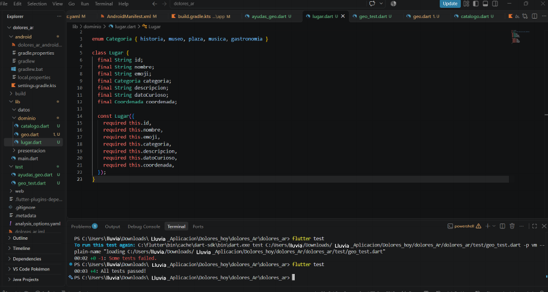

Ronda 2 · ¿Hacia dónde queda? Rumbo y ángulos
Ciclo 2.1 · ROJO
Ciclo 2.2 · VERDE
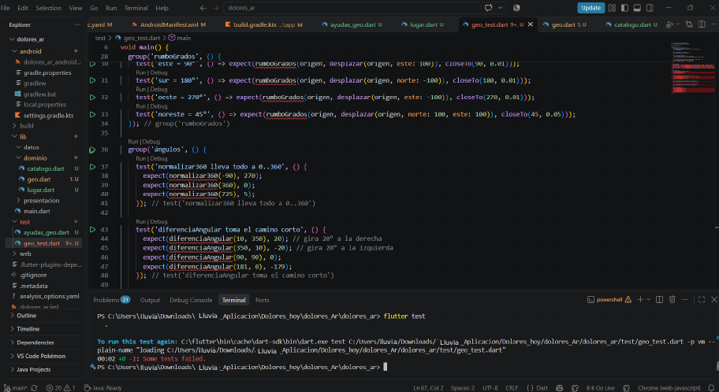
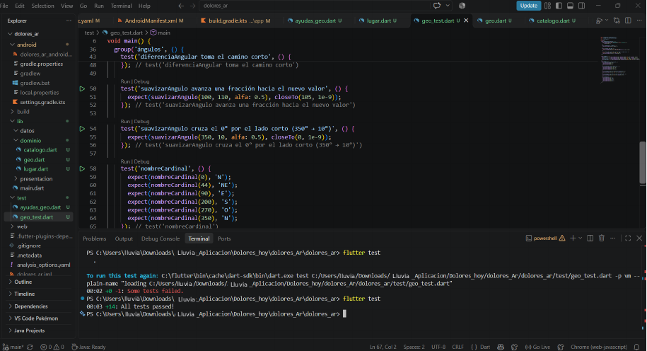

Ronda 3 · De ángulo a pantalla: el campo de visión
Ciclo 3.1 · ROJO
Ciclo 3.2 · VERDE
Ciclo 3.3 · Los lugares de Dolores Hidalgo
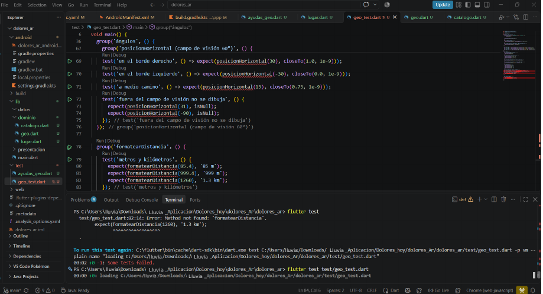
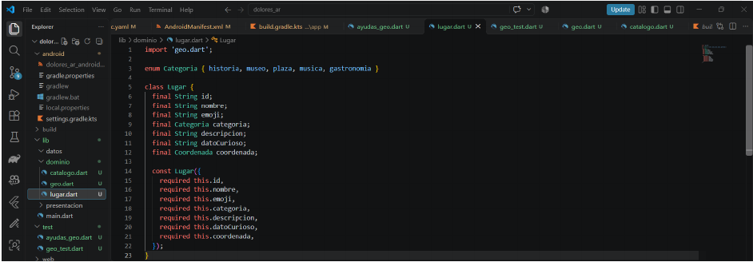
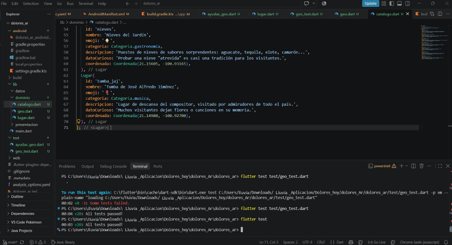

Ronda 4 · El motor de realidad aumentada
Ciclo 4.1 · ROJO
Ciclo 4.2 · VERDE
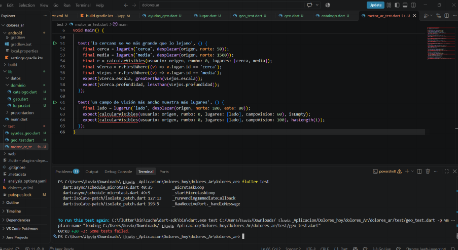
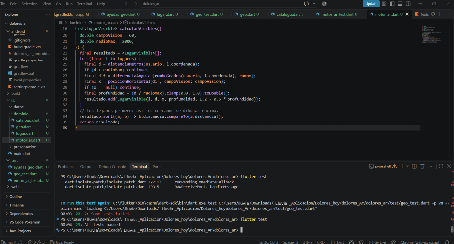

Ronda 5 · El pasaporte turístico (gamificación)
Ciclo 5.1 · ROJO
Ciclo 5.2 · VERDE
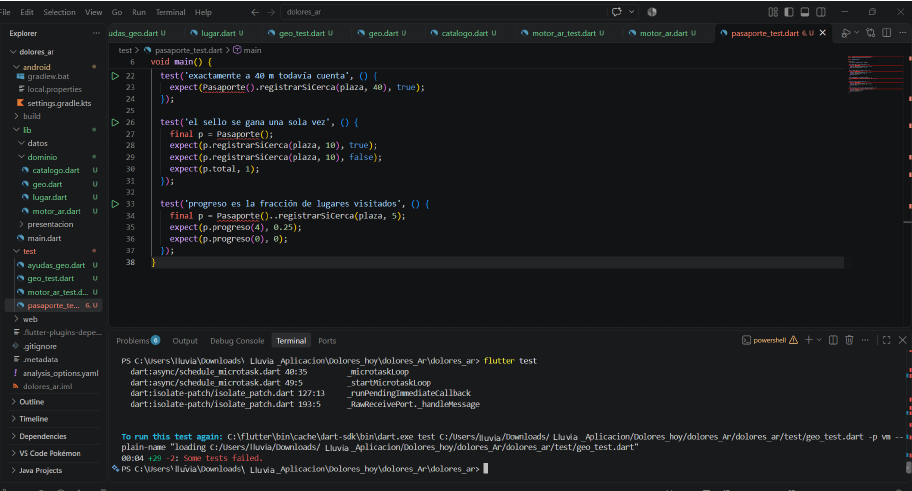

Ronda 6 · Fuentes de datos y el ViewModel
Ciclo 6.1 · ROJO: el ViewModel
Ciclo 6.2 · VERDE
Paso 6.3 · Las implementaciones concretas
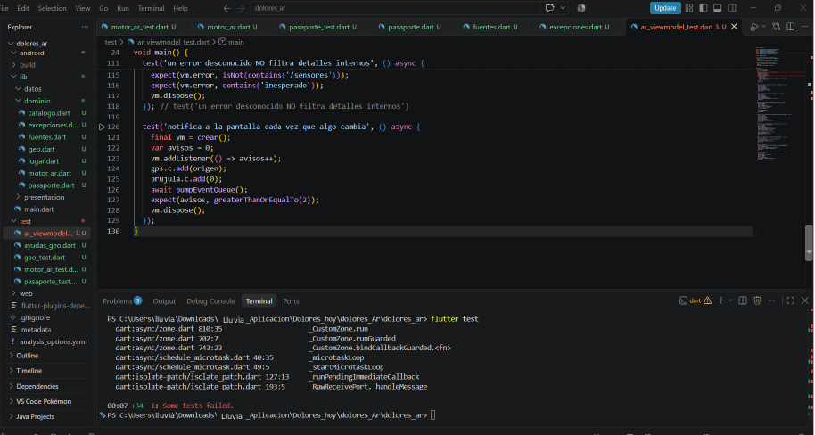
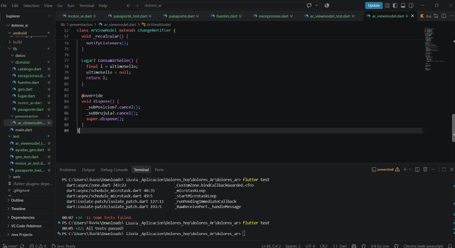
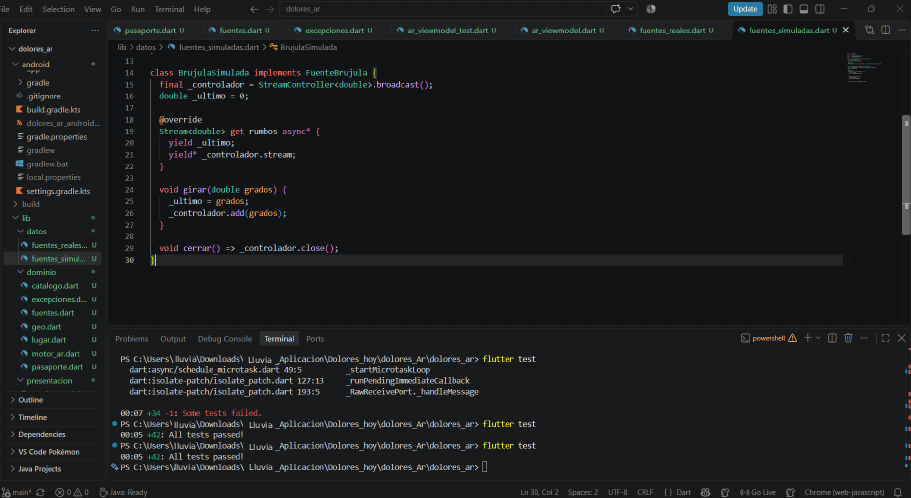

Ronda 7 · La pantalla de realidad aumentada
Paso 7.1 · El fondo de cámara
Paso 7.2 · La pantalla de RA
Paso 7.3 · Inicio con modo demo, y main
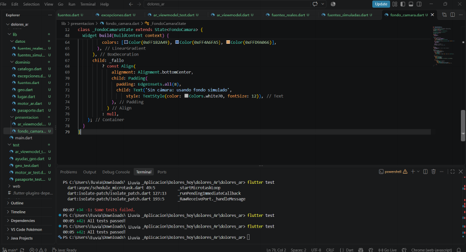

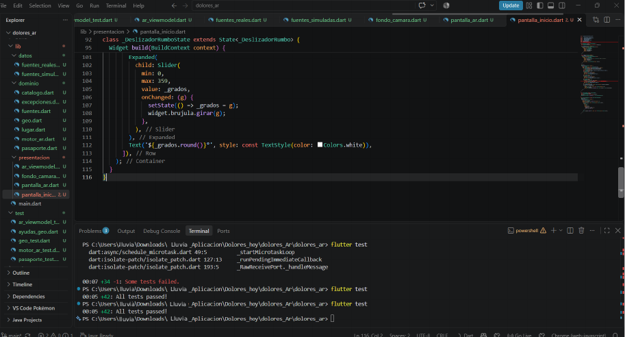
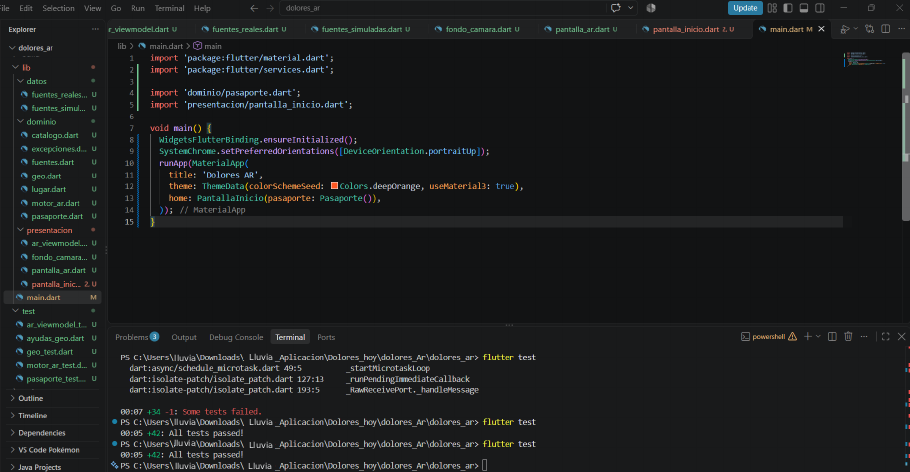

Ronda 8 · RA de superficie: modelo 3D en tu espacio
Paso 8.1 · La pantalla
Paso 8.2 · ¿De dónde saco un modelo 3D propio?
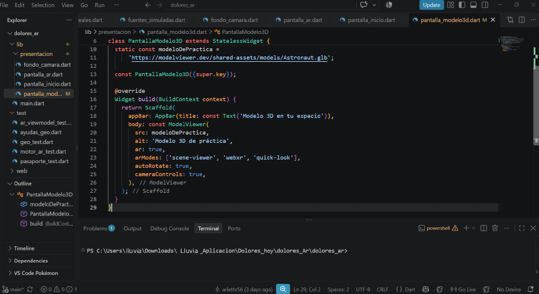

Ronda 9 · Prueba de campo, privacidad y seguridad
9.1 · Calibrar el catálogo (tarea de campo)
9.2 · Calibrar la brújula
9.3 · Tabla de problemas comunes
9.4 · Privacidad: tu ubicación es un dato sensible
9.5 · Seguridad física y responsabilidad
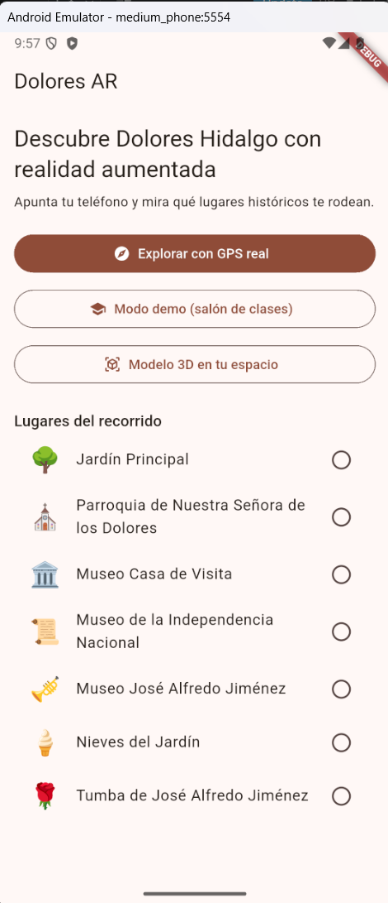
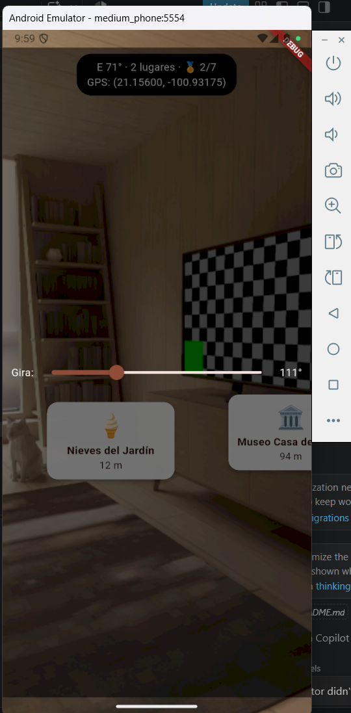
